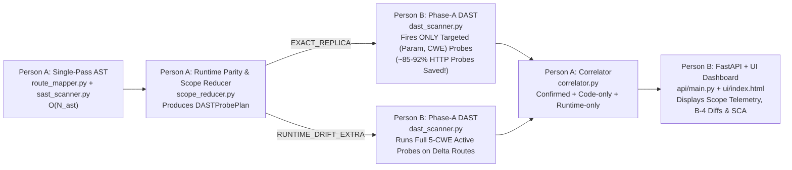

# CyberForge (Mitigata Hackathon) — Renewed Team-of-2 Implementation Plan (Phase 2 to Final Submission)
**Track:** `PROBLEM 06 · FLAGSHIP` — SAST and DAST Correlation (`CYBERFORGE CORRELATE` / `GORDON CORRELATE`)  
**Format:** 24-Hour Overnight Sprint · Team of 2 (`Person A` + `Person B`)  
**Current Baseline:** Branch `phase-1-implementation` (`commit e80055d`) · `31/31` Pytest Tests Passing (`0.63s`) · Live Storefront (`:5000`) & Main Scanner (`:8000`) Running  
**Active Timeline:** **Phase 2 (`7:30 PM – 10:30 PM`)** → **Phase 3 (`10:30 PM – 2:30 AM`)** → **Phase 4 (`2:30 AM – 7:00 AM`)** → **Phase 5 (`7:00 AM – 11:00 AM Day 2`)**

---

## 0. Current Baseline & Checkpoint 1 Judge Mandate

### 0.1 What Is Already Built & Verified on `phase-1-implementation` (`e80055d`)
1. **Shared Frozen Contract (`core/schemas.py`, `core/config.py`):**
   - `RouteEntry`, `CanonicalFinding`, `CorrelatedIssue`, `SCAFinding`, `ScopeReductionReport`, `DASTProbePlan`, `RouteParityEntry`.
   - Localhost-only Target Safety Guard (`127.0.0.1` / `localhost`, `follow_redirects=False`).
2. **Person A Static, Scope-Reduction, Correlation & SCA Engines (v1.5 Working):**
   - `engine/route_mapper.py`: Polyglot AST Route Mapper (Flask, FastAPI, Django, Express.js) + 3-hop cross-file call graph (`called_func_details`) + Blueprint/APIRouter prefix resolution.
   - `engine/sast_scanner.py`: AST Taint & Sink Scanner across all 6 CWEs (`CWE-89`, `79`, `78`, `22`, `601`, `798`) + Express JS scanner + SARIF v2.1.0 & Bandit JSON ingestion.
   - `engine/decoy_filter.py`: `B-2` Safe Decoy Filter suppressing parameterized SQL, `shell=False`, `shlex.quote`, `secure_filename`, `realpath+startswith`, allowlists, `int()` casts, and dead unreachable code.
   - `engine/scope_reducer.py`: Checkpoint 1 Judge's **Runtime-Verified SAST-to-DAST Adaptive Scope Reduction** (`EXACT_REPLICA` vs `RUNTIME_DRIFT_EXTRA` vs `CODE_ONLY_UNMOUNTED`).
   - `engine/correlator.py`: Multi-Signal Deterministic Correlator (`Confirmed`, `Code only`, `Runtime only`, 3 Hard Negative Vetoes, FR-6 deduplication, `B-3` `link_reason`, `B-4` context-aware Before/After code diff patches).
   - `engine/sca_reachability.py`: 5-Step Reachability-Aware SCA (`Reachable`, `Imported-only`, `Present-only`, `Unknown` + supply-chain typosquatting/unpinned checks).
   - `tests/mock_shop_app/`: Interactive vulnerable storefront & exploit console at `http://localhost:5000` (`app.py`, `templates/storefront.html`, `routes/orders.py`, `services/order_service.py`).
3. **Person B Runtime DAST, API/SQLite & UI Dashboard (v1 Working):**
   - `engine/dast_scanner.py`: 2-Phase Async DAST Scanner (Phase-A Active + Phase-B Passive headers/cookies/CORS/banners).
   - `api/db.py`, `api/main.py`, `ui/index.html`: FastAPI server, SQLite persistence (`FR-6` idempotency, `B-5` scan diffing), and initial Web UI at `http://localhost:8000`.

### 0.2 Checkpoint 1 Judge Feedback (Core Theme for Phase 2 & Checkpoint 2)
1. **Single-Pass Parsing & Linear Time Complexity:** DAST must never re-parse the codebase. Static AST extraction runs once in $O(N_{\text{AST}})$ and feeds both SAST and DAST in memory.
2. **Runtime-Verified Adaptive DAST Scope Reduction:**
   - **Rule:** Compare the static AST route table against live runtime endpoints first.
   - **If `EXACT_REPLICA` (`Code Route == Live Runtime Route`):** Prune 100% of safe/decoy routes from active Phase-A DAST fuzzing, and restrict active probes on tainted routes to **only the specific `(param, CWE)` pairs** flagged by SAST.
   - **If `RUNTIME_DRIFT_EXTRA` (`Live Runtime Route != Code Route`):** Fall back to full 5-CWE active probing on the drifted/unmapped runtime routes so shadow endpoints are still caught.



---

## 1. Strict Zero-Merge-Conflict File Ownership Matrix (`A ∩ B = ∅`)

> [!IMPORTANT]
> **Golden Rule for Zero Merge Conflicts:**
> **Person A** and **Person B** work on strictly disjoint sets of files (`A ∩ B = ∅`).
> - **Person A** NEVER edits `engine/dast_scanner.py`, `engine/auto_verify.py`, `api/*`, `ui/*`, `tests/test_subblock1_dast_and_db.py`, `Dockerfile`, `docker-compose.yml`, or `README.md`.
> - **Person B** NEVER edits `engine/route_mapper.py`, `engine/sast_scanner.py`, `engine/decoy_filter.py`, `engine/scope_reducer.py`, `engine/correlator.py`, `engine/sca_reachability.py`, `tests/mock_shop_app/**`, `tests/demo_checkpoint1.py`, `tests/test_person_a.py`, or `tests/test_correlation.py`.
> - **`core/schemas.py` and `core/config.py` are FROZEN.** Both already contain every field needed by both teammates.

| Dimension | **Person A (Static Intelligence, Scope Reducer, Correlator, SCA & Benchmark Lead)** | **Person B (Runtime DAST, Auto-Verify, FastAPI, SARIF/Docker & UI Dashboard Lead)** |
| :--- | :--- | :--- |
| **Working Branch** | `phase-1-implementation` *(STRICTLY NO NEW BRANCHES — stay on `phase-1-implementation`)* | `phase-1-implementation` *(or Person B's existing branch merged into `phase-1-implementation`)* |
| **Exclusive `engine/` Files** | • `engine/route_mapper.py`<br>• `engine/sast_scanner.py`<br>• `engine/decoy_filter.py`<br>• `engine/scope_reducer.py`<br>• `engine/correlator.py`<br>• `engine/sca_reachability.py` | • `engine/dast_scanner.py`<br>• `engine/auto_verify.py` *(new)* |
| **Exclusive `api/` & `ui/` Files** | *(None — Hands Off!)* | • `api/main.py`<br>• `api/db.py`<br>• `api/sarif_exporter.py` *(new)*<br>• `ui/index.html` |
| **Exclusive `tests/` & Root Files** | • `tests/mock_shop_app/**`<br>• `tests/demo_checkpoint1.py`<br>• `tests/test_person_a.py`<br>• `tests/test_correlation.py` | • `tests/test_subblock1_dast_and_db.py`<br>• `Dockerfile` *(new)*<br>• `docker-compose.yml` *(new)*<br>• `.github/workflows/cyberforge-gate.yml` *(new)*<br>• `README.md` *(new)* |
| **PRD Requirements Owned** | `FR-1`, `FR-4`, `FR-5`, `FR-6`, `B-2`, `B-3`, `B-4`, `B-7`, **Page 4 SCA Bonus**, **Judge Scope Reduction Algorithm** | `FR-2`, `FR-3`, `FR-7`, `FR-8`, `FR-9`, `FR-10`, `B-1`, `B-5`, `B-6`, **Judge Scope Reduction Execution in DAST & UI Telemetry** |

---

## 2. Clean Function-Call Bridge Between Person A and Person B

So `api/main.py` (Person B) and `engine/correlator.py` / `engine/scope_reducer.py` (Person A) plug together automatically without either person editing the other's code, we use these exact module-level entrypoints:

1. **`engine/route_mapper.py` (Person A exports $\rightarrow$ Person B calls in `api/main.py`):**
   - `build_route_map(source_dir: str) -> List[RouteEntry]` *(already implemented)*
2. **`engine/sast_scanner.py` (Person A exports $\rightarrow$ Person B calls in `api/main.py`):**
   - `run_sast_scan(source_dir: str, routes: Optional[List[RouteEntry]] = None) -> List[CanonicalFinding]` *(already implemented)*
3. **`engine/scope_reducer.py` (Person A exports $\rightarrow$ Person B calls in `engine/dast_scanner.py` & `api/main.py`):**
   - `build_dast_probe_plan(routes: List[RouteEntry], sast_findings: List[CanonicalFinding], live_endpoints: Optional[List[Tuple[str, str]]] = None) -> DASTProbePlan` *(Person A adds thin top-level wrapper around `RuntimeScopeReducer().build_dast_probe_plan(...)`)*
4. **`engine/correlator.py` (Person A exports $\rightarrow$ Person B calls in `api/main.py`):**
   - `correlate_findings(routes: List[RouteEntry], sast_findings: List[CanonicalFinding], dast_findings: List[CanonicalFinding], source_dir: Optional[str] = None, live_endpoints: Optional[List[Tuple[str, str]]] = None) -> List[CorrelatedIssue]` *(Person A adds top-level function so `api/main.py` line 627 automatically uses Person A's full `Correlator` with `B-4` code-diff patches and multi-hop matching!)*
5. **`engine/sca_reachability.py` (Person A exports $\rightarrow$ Person B calls in `api/main.py`):**
   - `run_sca_reachability(source_dir: str, routes: Optional[List[RouteEntry]] = None) -> List[SCAFinding]` *(already implemented)*

---

## 3. Renewed Phase-Wise Plan (Phase 2 → Phase 5) for Both Teammates

---

### PHASE 2: `7:30 PM – 10:30 PM` (Day 1 Evening) — **Judge Scope Reduction Integration, `B-1` Auto-Verify & Multi-Hop Hardening**

#### 👤 Person A Tasks (`7:30 PM – 10:30 PM`) — *Files: `engine/scope_reducer.py`, `engine/correlator.py`, `engine/route_mapper.py`, `engine/decoy_filter.py`*
- **Task A2.1 (`7:30 PM – 8:15 PM`): Top-Level Bridge Functions in `engine/correlator.py` & `engine/scope_reducer.py`**
  1. Add module-level `correlate_findings(routes, sast_findings, dast_findings, source_dir=None, live_endpoints=None) -> List[CorrelatedIssue]` in `engine/correlator.py` so `api/main.py` line 627 automatically calls Person A's `Correlator` (bringing `B-4` Before/After remediation diffs, 3-hop helper attribution, and parameter conflict vetoes straight into the API/UI).
  2. Add module-level `build_dast_probe_plan(routes, sast_findings, live_endpoints=None) -> DASTProbePlan` in `engine/scope_reducer.py` so Person B's `dast_scanner.py` and `api/main.py` can request the reduced probe plan in 1 line of code.
- **Task A2.2 (`8:15 PM – 9:30 PM`): Harden `engine/route_mapper.py` & `engine/decoy_filter.py` for Unseen-App Edge Cases**
  1. Support nested FastAPI `APIRouter` chains (`app.include_router(api_router, prefix="/api")` $\rightarrow$ `api_router.include_router(v1_router, prefix="/v1")`), Flask class-based views (`MethodView`), and Express `router.route('/items/:id').get(...).post(...)`.
  2. Expand `engine/decoy_filter.py` to recognize additional real-world sanitizers (`markupsafe.escape`, `bleach.clean`, `urllib.parse.urlsplit` netloc checks, SQLAlchemy `.filter_by()`, Django ORM `.filter()`, `pathlib.Path.resolve().is_relative_to()`).
- **Task A2.3 (`9:30 PM – 10:30 PM`): Dinner & Sync #1 with Person B**
  - Merge `feat/a-phase2-engine` and `feat/b-phase2-ui-runtime` into `phase-1-implementation`.

#### 👤 Person B Tasks (`7:30 PM – 10:30 PM`) — *Files: `engine/dast_scanner.py`, `engine/auto_verify.py`, `api/main.py`*
- **Task B2.1 (`7:30 PM – 8:30 PM`): Wire `DASTProbePlan` into `engine/dast_scanner.py` (Judge Scope Reduction in Action)**
  1. In `DASTScanner.scan()`, optionally accept `sast_findings: Optional[List[CanonicalFinding]] = None` or `probe_plan: Optional[DASTProbePlan] = None`.
  2. After the lightweight crawl/handshake discovers `live_endpoints`, call `scope_reducer.build_dast_probe_plan(routes, sast_findings, live_endpoints)`:
     - Skip Phase-A active fuzzing on routes where `should_fuzz_active == False` (`EXACT_REPLICA` safe/decoy routes).
     - On `EXACT_REPLICA` tainted routes, only execute the CWE probe methods (`_probe_sqli`, `_probe_xss`, `_probe_cmdi`, `_probe_path_traversal`, `_probe_open_redirect`) listed in `target_cwes_by_param[param]`.
     - On `RUNTIME_DRIFT_EXTRA` routes (or when `sast_findings` is not passed), run all 5 CWE probes as before.
- **Task B2.2 (`8:30 PM – 9:30 PM`): Build `engine/auto_verify.py` (`B-1` Code-Only $\rightarrow$ Confirmed Active Verifier)**
  1. Implement `async def auto_verify_code_only_issues(base_url, routes, issues, auth_headers=None, auth_cookies=None) -> List[CorrelatedIssue]` (already hooked into `api/main.py` at line 640!).
  2. For any `Code only` issue in `CWE-89`, `79`, `78`, `22`, `601` whose file/line is covered by a `RouteEntry`, synthesize a targeted diagnostic request for that route + parameter. If verified at runtime, upgrade `status = "Confirmed"`, set `auto_verified = True`, attach the new `dast_evidence`, and recompute `risk_score`.
- **Task B2.3 (`9:30 PM – 10:30 PM`): Expose `scope_reduction` Telemetry in `api/main.py` (`POST /scans` & `GET /scans/{id}`) + Dinner Sync**
  - Include `scope_reduction` summary (`naive_probe_count`, `reduced_probe_count`, `probes_saved_count`, `scope_reduction_pct`, `exact_replica_routes`, `drifted_routes`, `time_complexity_summary`) in `api/main.py` scan responses so `ui/index.html` can render the Judge Complexity Banner.

---

### PHASE 3: `10:30 PM – 2:30 AM` (Overnight Sprint Part 1) — **36-Bug PRD Benchmark, SARIF Export (`B-6`), UI Upgrade & Docker Packaging**

#### 👤 Person A Tasks (`10:30 PM – 2:30 AM`) — *Files: `tests/mock_shop_app/**`, `engine/sca_reachability.py`, `tests/demo_checkpoint1.py`*
- **Task A3.1 (`10:30 PM – 12:00 AM`): Complete 36-Bug PRD Answer-Key Benchmark Mode in `tests/demo_checkpoint1.py`**
  1. Add a `--full-benchmark` mode and CLI flags (`--source-dir`, `--target-url`, `--export-json`) to `tests/demo_checkpoint1.py` so Person A can run both:
     - **Live Storefront Scan (`./tests/mock_shop_app` + `http://localhost:5000`)**
     - **Full 36-Bug PRD Answer-Key Benchmark (`20 Pairs + 10 Code-only + 6 Runtime-only + 8 Safe Decoys`)**
     - **Unseen Second App Scan (`--source-dir <unseen_path> --target-url <unseen_url>`)**
  2. Print a formatted **7-Metric PRD Page 4 Scorecard + Judge Scope Reduction Telemetry Table** in the terminal.
- **Task A3.2 (`12:00 AM – 1:15 AM`): Enhance `tests/mock_shop_app/` Storefront (`:5000`) & Multi-Scanner Demo Fixture**
  1. Add a sample SARIF file (`tests/mock_shop_app/semgrep_sample.sarif`) and Bandit JSON file (`tests/mock_shop_app/bandit_sample.json`) inside `tests/mock_shop_app/reports/` so during the demo we can prove **`FR-3` + `FR-6` Multi-Scanner Deduplication** (*"3 scanner findings on the same bug = 1 Confirmed issue"*).
- **Task A3.3 (`1:15 AM – 2:30 AM`): Harden `engine/sca_reachability.py` Call-Graph Trace & Supply-Chain Evidence**
  1. Ensure every `SCAFinding` returned by `run_sca_reachability()` includes a human-readable `call_chain` list (`["POST /api/config/import", "app.py:import_yaml_config() [line 166]", "yaml.load() [line 168]"]`) and `supply_chain_flags` (`["TYPOSQUAT_SUSPECT: reqeusts -> requests (distance=1)"]`) for Person B's UI table.

#### 👤 Person B Tasks (`10:30 PM – 2:30 AM`) — *Files: `api/sarif_exporter.py`, `api/main.py`, `ui/index.html`, `Dockerfile`, `docker-compose.yml`, `README.md`*
- **Task B3.1 (`10:30 PM – 12:00 AM`): Build `api/sarif_exporter.py` (`B-6` SARIF v2.1.0 Exporter & CI Gate)**
  1. Create `api/sarif_exporter.py` exporting `CorrelatedIssue` and `SCAFinding` items into OASIS **SARIF v2.1.0** format (`$schema`, `runs[0].tool.driver`, `results` with `locations[0].physicalLocation` for `file:line` and `properties` for `status`, `url`, `param`, `payload`, `evidence`, `risk_score`, `fair_exposure_inr_lakhs`).
  2. Add `GET /scans/{scan_id}/sarif` and `GET /scans/{scan_id}/ci-gate` in `api/main.py` (returns exit status `FAIL` if any `Confirmed` Critical/High issue or `Reachable` KEV SCA CVE exists, else `PASS`).
- **Task B3.2 (`12:00 AM – 1:30 AM`): Upgrade `ui/index.html` with Judge-Winning Visual Panels**
  1. **Judge Complexity & Scope Reduction Banner:** Shows `Single-Pass AST O(N + K)`, `Naive Probes vs Reduced Probes`, `% Active HTTP Traffic Saved`, and per-route `EXACT_REPLICA` vs `RUNTIME_DRIFT_EXTRA` status badges.
  2. **Unified Issue Drawer (`FR-8` + `B-3` + `B-4`):** Displays side-by-side **Static Code Proof (`file:line` + snippet)** + **Live Runtime HTTP Proof (`url`, `param`, `payload`, `evidence`)** + **`B-3` Link Reason** + **`B-4` Before/After Code Remediation Diff**.
  3. **5-Step Reachability-Aware SCA Tab:** Displays `Reachable`, `Imported-only`, `Present-only`, and `Unknown (Never Downgraded)` badges + route-to-sink call chains + supply-chain alerts.
  4. **Scan Diff (`B-5`) & Export Bar (`B-6`):** `NEW` / `FIXED` / `STILL-OPEN` badges + 1-click **Download SARIF v2.1.0** button + direct link to `http://localhost:5000` Live Vulnerable Storefront.
- **Task B3.3 (`1:30 AM – 2:30 AM`): Create `Dockerfile`, `docker-compose.yml`, `.github/workflows/cyberforge-gate.yml` & `README.md`**
  1. Package the FastAPI + UI server (`:8000`) and the Live Vulnerable Storefront (`:5000`) in `docker-compose.yml` for 1-command judge reproducibility.

---

### PHASE 4: `2:30 AM – 7:00 AM` (Overnight Sprint Part 2) — **Staggered Rest Shifts & Unseen-App Torture Testing**

| Time Window | **Person A Schedule** | **Person B Schedule** |
| :--- | :--- | :--- |
| **`2:30 AM – 4:15 AM`** | 😴 **Person A Rest Shift (105 mins)** | 🖥️ **Person B Active:** Finish UI polish in `ui/index.html`, test SARIF download & scan diffing in `tests/test_subblock1_dast_and_db.py`. |
| **`4:15 AM – 6:00 AM`** | 🖥️ **Person A Active:** Build & run the **Unseen-App Torture Suite** in `tests/test_person_a.py` (Express.js `B-7`, FastAPI nested routers, Django `urlpatterns`, multi-param same-route disambiguation, 3-hop helper chains). | 😴 **Person B Rest Shift (105 mins)** |
| **`6:00 AM – 7:00 AM`** | 🤝 **Both Awake — Sync #2 & Pre-Drop Check:** Merge both branches into `phase-1-implementation`, run `python -m pytest -v`, verify `:5000` and `:8000` live flow before the `07:00 AM` Unseen App drop. | 🤝 **Both Awake — Sync #2 & Pre-Drop Check:** Verify UI dashboard renders all 5 Confirmed CWEs, Code-only, Runtime-only, SCA Reachability, and Scope Reduction metrics cleanly. |

---

### PHASE 5: `7:00 AM – 11:00 AM` (Day 2 Morning) — **07:00 AM Unseen App Drop, Checkpoint 2 & Final Jury Pitch**

| Time Window | **Person A Actions** | **Person B Actions** |
| :--- | :--- | :--- |
| **`7:00 AM – 8:15 AM`**<br>*(Unseen App Drop)* | 1. Run `RouteMapper` & `SASTScanner` on the organisers' unseen app folder.<br>2. Verify 100% of routes and parameters are extracted.<br>3. If the unseen app uses a custom decorator/wrapper, add the AST pattern in `engine/route_mapper.py` or `engine/sast_scanner.py`. | 1. Boot the organisers' unseen app container/process on a local port (e.g., `:5001`).<br>2. Trigger a full live scan from `http://localhost:8000` against the unseen app.<br>3. Verify `>65%` correlation rate, `0%` false alarms, and `<60s` runtime. |
| **`8:15 AM – 9:00 AM`** | Merge final branch into `phase-1-implementation` (and `main` when ready for freeze); run full `pytest -v` suite. | Capture screenshots & export SARIF report from both `mock_shop_app` (`:5000`) and the Unseen App (`:5001`). |
| **`9:00 AM – 10:30 AM`**<br>*(Checkpoint 2)* | **Pitch Part 1 (Architecture & Judge Feedback Defense):**<br>Show how `engine/scope_reducer.py` verifies `EXACT_REPLICA` runtime parity in single-pass $O(N + K)$ and prunes ~85–92% of unnecessary DAST probes while preserving `RUNTIME_DRIFT_EXTRA` coverage. | **Pitch Part 2 (Live Demo `:5000` $\rightarrow$ `:8000`):**<br>1. Trigger live SQLi, XSS, CMDi, and Path Traversal on `http://localhost:5000`.<br>2. Paste `http://localhost:5000` into `http://localhost:8000` and show all 5 Confirmed issues, `B-4` code diff fixes, and 5-Step SCA Reachability. |
| **`10:30 AM – 11:00 AM`** | Final submission check & 5-minute jury Q&A rehearsal. | Final submission check & browser tab setup (`localhost:5000` + `localhost:8000`). |

---

## 4. Git Workflow Rules to Guarantee Zero Merge Conflicts (STRICTLY NO NEW BRANCHES)

1. **Stay Directly on `phase-1-implementation` (Do NOT Create New Branches):**
   ```powershell
   git checkout phase-1-implementation
   git pull origin phase-1-implementation
   ```
2. **Stage & Commit ONLY Your Owned Files (`A ∩ B = ∅`):**
   - **Person A** ONLY runs:
     ```powershell
     git add engine/route_mapper.py engine/sast_scanner.py engine/decoy_filter.py engine/scope_reducer.py engine/correlator.py engine/sca_reachability.py tests/mock_shop_app tests/demo_checkpoint1.py tests/test_person_a.py tests/test_correlation.py IMPLEMENTATION_PLAN.md state.md
     ```
   - **Person B** ONLY runs:
     ```powershell
     git add engine/dast_scanner.py engine/auto_verify.py api/ ui/ tests/test_subblock1_dast_and_db.py Dockerfile docker-compose.yml README.md .github/
     ```
3. **Result:** Because the two file lists have **zero intersection (`A ∩ B = ∅`)**, `git pull --rebase origin phase-1-implementation` and `git push origin phase-1-implementation` will succeed with **0 merge conflicts** every single time without creating extra branches.
