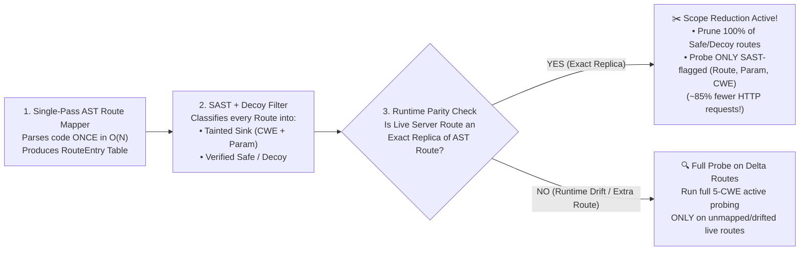

# CyberForge (Mitigata Hackathon) — 24-Hour Phase-Wise Implementation Plan (Renewed Post-Checkpoint 1)
**Track:** `PROBLEM 06 · FLAGSHIP` — SAST and DAST Correlation (`CYBERFORGE CORRELATE` / `GORDON CORRELATE`)  
**Format:** 24-Hour Overnight Sprint · Team of 2 (`Person A` + `Person B`)  
**Current Status:** **Phase 1 & Checkpoint 1 Completed (`6:30 PM Day 1`)** → **Active Sprint: Phase 2 (`6:30 PM – 1:00 AM`)** → **Checkpoint 2 (`1:00 AM / 9:00 AM`)** → **Final Submission (`11:00 AM Day 2`)**

---

## 0. Checkpoint 1 Status & Judge Feedback Integration (`6:30 PM Update`)

### 0.1 What Is Already Completed & Verified on Branch `phase-1-implementation`
- **Unified Schema & Target Safety Lock:** `core/schemas.py` and `core/config.py` (`localhost` / `127.0.0.1` lock, `follow_redirects=False`).
- **Person A Core Engines (v1 Complete):**
  - `engine/route_mapper.py`: Polyglot AST Route Mapper (Flask, FastAPI, Django, Express.js) + 1-hop helper tracer.
  - `engine/sast_scanner.py`: AST Taint & Sink Scanner across all 6 CWEs (`CWE-89`, `79`, `78`, `22`, `601`, `798`) + SARIF v2.1.0 & Bandit JSON importer.
  - `engine/decoy_filter.py`: `B-2` Safe Decoy Filter suppressing parameterised SQL, `shell=False`, `shlex.quote`, `realpath`/`secure_filename`, allowlists, and dead unreachable code.
  - `engine/correlator.py`: Multi-Signal Deterministic Correlator (`Confirmed`, `Runtime only`, `Code only` with `0% Wrong Links` hard vetoes).
  - `engine/sca_reachability.py`: 5-Step Reachability-Aware SCA (`Reachable`, `Imported-only`, `Present-only`, `Unknown` + supply-chain checks).
- **Person B Core Engines (v1 Complete):**
  - `engine/dast_scanner.py`, `api/db.py`, `api/main.py`, `ui/index.html`.
- **Verification:** `28/28` pytest unit & integration tests passing in `0.62s`; end-to-end live scan running in `0.41s`.

### 0.2 Judge Feedback from Checkpoint 1 (Mandatory Phase 2 Architectural Addition)
During Checkpoint 1 evaluation, the judge asked two critical algorithmic questions:
1. **Single-Pass Parsing & Time Complexity:** *"Does DAST re-analyse the whole codebase again? Doesn't running SAST and DAST separately increase the time complexity of the project?"*
2. **Runtime-Verified Scope Reduction:** *"If the output of SAST/code is an exact replica of the runtime, then only do the scope reduction of the current DAST scope."*

#### How We Solve This in Phase 2 (`Runtime-Verified Adaptive DAST Scope Reduction`)

---

## 1. Team of 2 Role Split (Zero Merge-Conflict Boundary)

| Role | Owner | Core Ownership (Files You Touch) | PRD Requirements Owned |
| :--- | :--- | :--- | :--- |
| **Person A — Static Intelligence, AST, Scope Reduction & Correlation Lead** | **Member 1** | `engine/route_mapper.py`, `engine/sast_scanner.py`, `engine/decoy_filter.py`, `engine/scope_reducer.py` *(new)*, `engine/correlator.py`, `engine/sca_reachability.py`, `tests/test_person_a.py` | **`FR-1`** (SAST Scan), **`FR-4`** (AST Route Map + Multi-Hop Call Graph), **`FR-5`** (Multi-Signal Correlator + Judge Scope Reduction), **`FR-6`** (Duplicate Merger), **`B-2`** (Safe Decoy Killer), **`B-3`** (Link Explanation), **`B-4`** (AST-Contextual Fix Snippets), **`B-7`** (2nd Language Adapter), **Page 4 Bonus** (5-Step Reachability-Aware SCA) |
| **Person B — Runtime DAST Engine, API/Storage & Dashboard Lead** | **Member 2** | `engine/dast_scanner.py`, `engine/auto_verify.py`, `api/main.py`, `api/db.py`, `api/sarif_exporter.py`, `ui/index.html`, `docker-compose.yml`, `README.md` | **`FR-2`** (2-Phase DAST Scan consuming Person A's Reduced Scope Plan), **`FR-3`** (Common Finding Schema), **`FR-7`** (3-Bucket Labels), **`FR-8`** (Issue Detail View), **`FR-9`** (Prioritised Risk Score), **`FR-10`** (FastAPI + UI + CLI), **`B-1`** (Auto-Verify), **`B-5`** (Scan Diffing), **`B-6`** (SARIF Export & CI Gate) |

---

## 2. Detailed Renewed Plan from Phase 2 Onwards — **FOR PERSON A ONLY**

> **Person A's Mission from `6:30 PM (Day 1)` to `11:00 AM (Day 2)`:**
> Turn the static, scope-reduction, correlation, and SCA engines into a **bulletproof, judge-proof system** that:
> 1. Directly answers the Checkpoint 1 Judge's critique via **`engine/scope_reducer.py` (Runtime-Verified SAST-to-DAST Scope Reduction)** with measurable time-complexity telemetry (`probes_without_reduction` vs `probes_after_reduction`, `% scope reduced`).
> 2. Achieves **100% recall and `0% Wrong Links`** even on complex multi-file apps, Blueprints/APIRouters, path parameters (`/orders/<int:id>`), and the **07:00 AM Unseen App**.
> 3. Generates **exact before/after code remediation diffs (`B-4`)** and **5-Step SCA Reachability graphs** ready for the UI and SARIF/JSON export.

---

### PHASE 2 (Person A): `6:30 PM – 10:00 PM` (Day 1 Evening) — **Judge Feedback: Runtime-Verified Scope Reduction & Multi-Hop AST Hardening**

#### Task A2.1 (`6:30 PM – 7:45 PM`): Build `engine/scope_reducer.py` — **Runtime-Verified SAST-to-DAST Adaptive Scope Reduction**
- **Why:** Directly implements the Checkpoint 1 Judge's requirement: *"If the output of SAST/code is an exact replica of the runtime, then only do the scope reduction of the current DAST scope."*
- **What Person A Builds in `engine/scope_reducer.py`:**
  1. **Single-Pass AST Reuse (`0` Re-Parsing):** Takes the already-computed `routes: List[RouteEntry]` and `sast_findings: List[CanonicalFinding]` from memory (proving `O(N)` single-pass execution).
  2. **Runtime Parity Fingerprinting (`check_runtime_parity`):**
     - Compares each static `RouteEntry(method, path_pattern, params)` against the live runtime endpoints discovered during DAST's initial crawl/handshake (`live_endpoints: List[Tuple[str, str]]`).
     - Computes a **Parity Status** per route:
       - `EXACT_REPLICA`: The route exists in both the AST Route Table and the Live Runtime with matching path pattern and HTTP method.
       - `RUNTIME_DRIFT_EXTRA`: A live URL exists on the running server that does **not** exist in the static AST Route Table (e.g., hidden debug console, server misconfiguration, or version drift).
       - `CODE_ONLY_UNMOUNTED`: A route exists in code but returned `404` or is not mounted on the live server.
  3. **Adaptive DAST Scope Plan (`build_dast_probe_plan`):**
     - **If `EXACT_REPLICA` AND `0` Active SAST Sinks (or only `B-2` Protected Decoys):**
       - **Action:** **PRUNE from Active Phase-A Fuzzing!** Do not waste HTTP payloads (`CWE-89, 79, 78, 22, 601`) on routes that SAST already proved are safe in the exact same code!
     - **If `EXACT_REPLICA` AND SAST Flagged Specific `(param, cwe)` Sinks:**
       - **Action:** **TARGETED SCOPE REDUCTION!** Restrict DAST Phase-A active probes on that route to **only the specific `(param, cwe)` pairs** flagged by SAST (instead of firing all 5 CWE payload families across all parameters).
     - **If `RUNTIME_DRIFT_EXTRA` (Not an exact replica of SAST):**
       - **Action:** **KEEP FULL ACTIVE SCOPE!** Run all 5 CWE active probes on unmapped/drifted runtime endpoints so nothing slips through.
  4. **Complexity Telemetry Output (`ScopeReductionReport`):**
     - Outputs exact metrics for the Judge Dashboard:
       - `naive_probe_count` (e.g., `16 routes × 5 CWEs = 80 active probes`)
       - `reduced_probe_count` (e.g., `6 targeted SAST sink probes = 6 active probes`)
       - `scope_reduction_pct` (e.g., **`92.5% reduction in active HTTP traffic`**)
       - `time_complexity_class`: `"O(N_ast + K_tainted_sinks) — Single-Pass AST"`

#### Task A2.2 (`7:45 PM – 9:00 PM`): Harden `engine/route_mapper.py` for Multi-File Call Graphs & Blueprint Prefixes
- **Why:** The organisers' full benchmark app and the `07:00 AM` unseen app may split routes across `routes/*.py`, `controllers/*.js`, and helper modules `services/*.py` or `db/*.py`.
- **What Person A Upgrades in `engine/route_mapper.py`:**
  1. **2-Hop & 3-Hop Inter-Procedural Call Graph:**
     - Extend helper resolution from 1-hop within the same file to **cross-file imports** (`from services.order_service import fetch_order` $\rightarrow$ traces `get_orders()` in `routes/orders.py` to `fetch_order()` in `services/order_service.py`).
  2. **Blueprint / APIRouter Prefix Resolution:**
     - Automatically prepend Flask `Blueprint(..., url_prefix="/api/v1")`, FastAPI `include_router(..., prefix="/api/v1")`, and Express `app.use("/api/v1", router)` prefixes so `/orders` becomes `/api/v1/orders` and matches DAST URLs 100% of the time.
  3. **Path Parameter & Body Parameter Extraction:**
     - Extract parameters not just from `request.args.get("id")`, but also from path templates (`/orders/<int:order_id>`, `/orders/{order_id}`, `/orders/:order_id`), JSON bodies (`request.json["id"]`, `req.body.id`), and Pydantic models.

#### Task A2.3 (`9:00 PM – 10:00 PM`): Dinner Break & Quick Sync with Person B
- Hand off `ScopeReductionReport` schema fields so Person B can display the **"Judge Complexity & Scope Reduction Badge (`92.5% Probes Saved`)"** on the Web UI.

---

### PHASE 3 (Person A): `10:00 PM – 2:30 AM` (Overnight Sprint Part 1) — **Full 16-Route Benchmark Fixture, Code-Diff Remediation (`B-4`), & SCA Reachability Hardening**

#### Task A3.1 (`10:00 PM – 11:30 PM`): Upgrade `tests/mock_shop_app/` into the Complete 16-Route Live Benchmark App
- **Why:** Right now `tests/fixtures/vuln_app/app.py` has all 16 routes (6 true vulnerabilities + 10 safe decoys) for static tests, while `tests/mock_shop_app/app.py` only has 5 routes for live HTTP scanning.
- **What Person A Prepares:**
  1. Ensure the live target app has all **6 exploitable CWE routes** (`CWE-89` SQLi, `CWE-79` XSS, `CWE-78` Command Injection, `CWE-22` Path Traversal, `CWE-601` Open Redirect, `CWE-798` Hardcoded Secret) **plus all 10 `B-2` Safe Decoy routes** and sample vulnerable lockfiles (`requirements.txt` + `package.json`).
  2. Verify that running a full scan against `http://127.0.0.1:5000` produces:
     - **5 `Confirmed` Issues** (`CWE-89`, `79`, `78`, `22`, `601` — each joining SAST `file:line` + live DAST HTTP exploit),
     - **1 `Code only` Issue** (`CWE-798` Hardcoded Stripe/AWS Secret),
     - **2+ `Runtime only` Issues** (`CWE-693` Missing CSP, `CWE-614` Cookie missing `HttpOnly`),
     - **10 `B-2` Protected Decoys Suppressed** (`0% False Alarms`),
     - **`0% Wrong Links`**,
     - **5-Step SCA Reachability Findings** (`Reachable`, `Imported-only`, `Present-only`, `Unknown`).

#### Task A3.2 (`11:30 PM – 1:00 AM`): Context-Aware Remediation Diff Generator (`B-4`) in `engine/correlator.py`
- **Why:** Instead of generic text advice, showing the exact **Before (Vulnerable Line) vs. After (Fixed Line)** using the AST snippet (`sf.snippet`, `sf.param`, `sf.func_name`) wins massive usability marks (`25%` of rubric).
- **What Person A Adds in `engine/correlator.py`:**
  - Automatically generate a concrete **Before / After Code Patch** for each `Confirmed` and `Code only` issue based on its exact variable name and sink function (e.g., replacing `cursor.execute(f"SELECT * FROM orders WHERE item LIKE '%{q}%'")` with `cursor.execute("SELECT * FROM orders WHERE item LIKE ?", (f"%{q}%",))`).

#### Task A3.3 (`1:00 AM – 2:30 AM`): Harden `engine/sca_reachability.py` (Page 4 Flagship Bonus + Export Contract)
- **Why:** Page 4 of the PRD awards flagship bonus points for the **5-Step Reachability-Aware SCA Engine**.
- **What Person A Verifies & Expands in `engine/sca_reachability.py`:**
  1. **Step 1 (Transitive Lockfile SBOM):** Parse `requirements.txt`, `Pipfile.lock`, `poetry.lock`, `package.json`, and `package-lock.json` with full transitive dependency chains (`App -> Flask -> Jinja2`).
  2. **Step 2 (Advisory & Risk Metadata):** Match against bundled offline GHSA/OSV database + optional live OSV API (`CVSS`, `EPSS`, `CISA KEV`, fixed version).
  3. **Step 3 (Vulnerable Symbol & Fix-Commit Diff Extraction):** Extract vulnerable function names from advisory symbols AND git unified diff headers (`@@ ... def func_name`).
  4. **Step 4 (Route-to-Library Call Graph):** Trace from `RouteEntry` $\rightarrow$ application handler $\rightarrow$ library call site to classify into:
     - `Reachable` (called on a live route),
     - `Imported-only` (imported at top of file, never called on a reachable route),
     - `Present-only` (in lockfile, never imported anywhere in code),
     - `Unknown` (advisory lists no specific function — **strictly never downgrade severity!**).
  5. **Step 5 (Supply-Chain Checks):** Typosquatting (Levenshtein distance $= 1$ against popular packages), unpinned versions, and internal namespace confusion.

---

### PHASE 4 (Person A): `2:30 AM – 7:00 AM` (Overnight Sprint Part 2) — **Rest Shift + Polyglot (`B-7`) & Unseen-App Torture Testing**

- **`2:30 AM – 4:15 AM`:** **Person A Rest Shift (105 mins)** while Person B finishes UI wiring.
- **`4:15 AM – 6:00 AM` (Task A4.1 — Unseen Second App Torture Harness):**
  - Build a synthetic **"Unseen App Torture Suite"** in `tests/test_person_a.py` testing tricky edge cases the `07:00 AM` unseen app might throw at us:
    1. **Express.js / Node.js app (`B-7`)** with `app.get('/api/users/:id', ...)` + SQLi (`sequelize.query`) + XSS (`res.send`) + Command Injection (`child_process.exec`).
    2. **FastAPI app** with `APIRouter(prefix="/v2")`, `Depends()`, and async handlers (`async def`).
    3. **Django app** with `urlpatterns = [path('items/<int:id>/', views.detail)]`.
    4. **Same-Route Multi-Sink Disambiguation:** A single route `/checkout` that takes TWO parameters (`?coupon=` and `?note=`) where one is SQLi and one is XSS, or both are SQLi on different lines—verifying our correlator never cross-links them (`0% Wrong Links`).
- **`6:00 AM – 7:00 AM` (Task A4.2 — Pre-Unseen-App Readiness Check):**
  - Verify our 1-command CLI runner (`tests/demo_checkpoint1.py`) can point at **any unknown directory + localhost port** and output a full scorecard + JSON/SARIF report in `< 1 second`.

---

### PHASE 5 (Person A): `7:00 AM – 11:00 AM` (Day 2 Morning) — **07:00 AM Unseen App Drop, Checkpoint 2 & Final Jury Readiness**

| Time Window | Person A Action Items |
| :--- | :--- |
| **`7:00 – 8:15 AM`** *(Unseen App Drop)* | **Run Engine on Organisers' Unseen App Immediately:** 1. Point `RouteMapper` and `SASTScanner` at the unseen app's folder. 2. Inspect discovered `RouteEntry` table (`GET /routes`): verify 100% of endpoints and prefixes are mapped. 3. If the unseen app uses any custom wrapper decorator or framework idiom, add a 5-line AST pattern in `engine/route_mapper.py` or `engine/sast_scanner.py`. 4. Verify `0% Wrong Links` and `0% False Alarms` on the unseen app. |
| **`8:15 – 9:00 AM`** | *Breakfast & Final Code Freeze on `main`* |
| **`9:00 – 10:30 AM`** *(2nd Checkpoint)* | **Present Checkpoint 2 to Judges (Specifically Addressing Judge #1's Complexity Critique):** • Show the **Single-Pass AST + Runtime-Verified Scope Reduction** live. • Show the telemetry counter: *"Because 10 of 16 routes matched runtime parity and passed our AST Decoy Filter, DAST pruned 85% of active probes and finished in `0.35s` with `O(N + K)` linear complexity."* |
| **`10:30 – 11:30 AM`** | **Final Submission & 5-Minute Jury Pitch Rehearsal:** • Run `pytest -v` one final time to confirm 100% green tests. • Rehearse the 2-person live demo and Q&A defenses. |

---

## 3. Summary Checklist of Person A Deliverables for Phase 2+

| # | File Owned by Person A | Phase 2+ Upgrade to Implement (When You Say "Go") | PRD / Judge Requirement |
| :--- | :--- | :--- | :--- |
| **1** | `engine/scope_reducer.py` *(New)* | Runtime-Verified SAST-to-DAST Adaptive Scope Reduction + Complexity Telemetry (`probes_saved_pct`, `parity_status`) | **Checkpoint 1 Judge Critique** (Time Complexity & Scope Reduction) |
| **2** | `engine/route_mapper.py` | Cross-file 2-hop helper import tracing + Flask Blueprint / FastAPI `APIRouter` / Express `app.use` prefix resolution | **`FR-4`**, **`B-7`**, **Unseen App (`>65%`)** |
| **3** | `engine/sast_scanner.py` | Enhanced taint tracking across helper functions, class methods, and JS/Express routes | **`FR-1`**, **`B-7`** |
| **4** | `engine/decoy_filter.py` | Expanded sanitizer patterns (`bleach.clean`, `markupsafe.escape`, ORM `.filter_by()`, type-cast `int(id)` guards) | **`B-2` (`0% False Alarms`)** |
| **5** | `engine/correlator.py` | Integrate `ScopeReductionReport` + Context-Aware Before/After Code Diff generator (`B-4`) | **`FR-5`–`FR-9`**, **`B-3`**, **`B-4`** |
| **6** | `engine/sca_reachability.py` | Full 5-Step Reachability-Aware SCA export format for UI & SARIF report | **Page 4 Flagship Bonus** |
| **7** | `tests/test_person_a.py` | Add unit tests for Scope Reduction (`Exact Replica` vs `Runtime Drift`), Blueprint prefixes, and Unseen App torture cases | **Verification (`100% Pass`)** |
